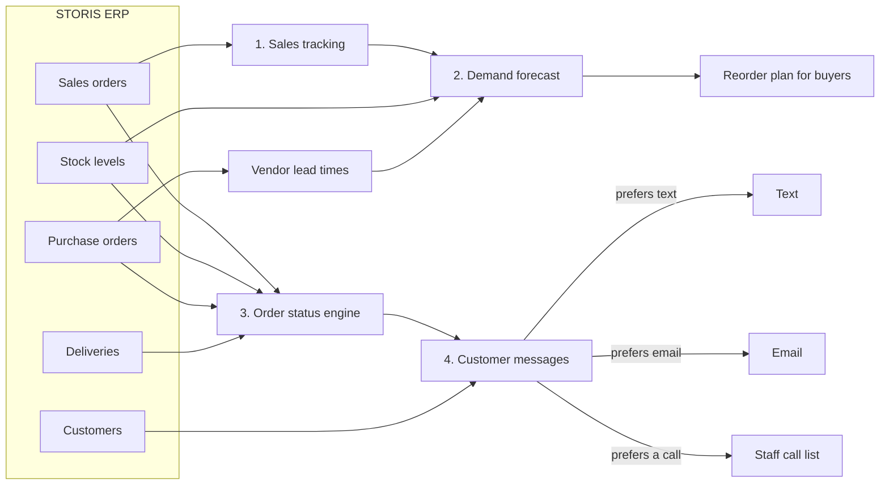
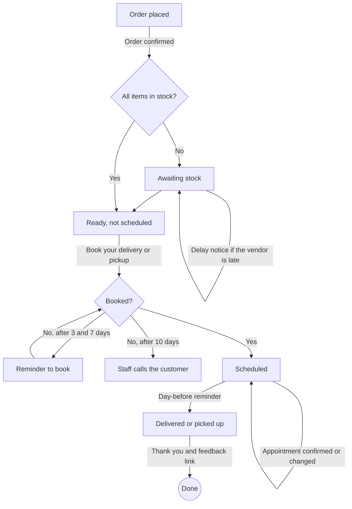

# Furniture Retail Agent

An AI agent for a furniture retailer that runs on top of the store's ERP (STORIS). Every day it:

1. **Tracks sales** across showrooms and the web store.
2. **Forecasts when to reorder** each product, using real vendor lead times.
3. **Tells customers when to book** delivery or pickup once their order is ready.
4. **Sends order status updates** by text or email, like package tracking.

Coming next: market-level demand estimates and live in-transit updates. See [Planned](#planned).

> This repository describes how the agent works. The source code is private.
> All numbers and customers shown here come from a synthetic dataset built to match the shape of STORIS data (21 months of history, about 10,700 orders). No real customer data is used.

---

## How it works

### The life of a customer order

---

## Stage by stage

### 1. Sales tracking
The agent reads every sales order and order line from STORIS and turns them into daily demand per product. Cancelled and backordered lines still count, because they were real customer demand. It also learns the store's rhythm: busier weekends and the big furniture sale events (Presidents Day, Memorial Day, July 4, Labor Day, Black Friday).

### 2. Reorder forecasting
For each of the 120 products, the agent forecasts the next 26 weeks of sales and compares that with the stock on hand and already on order. It uses how late each vendor *actually* delivers, not the lead time they promise, and keeps a safety buffer so the store can fill about 95% of demand. The result is a plan for buyers: what to order, how many, and the last day to place the order.

**Sample reorder plan (top rows):**

| Product | Action | Order by | Suggested qty | Stockout date if nothing changes |
|---|---|---|---|---|
| Wood Chair, Black | Order now | Oct 12 | 591 | Already out (80 backordered) |
| Fabric Table, Black | Order now | Oct 12 | 544 | Already out (76 backordered) |
| Plastic Chair, White | Order now | Oct 12 | 59 | Nov 19 |
| Metal Chair, Blue | Order now | Oct 12 | 50 | Dec 19 |

**Today's summary:**

| Action | Products | Units |
|---|---|---|
| Order now | 35 | 1,947 |
| Order this week | 17 | 149 |
| Order within 5 weeks | 46 | n/a |
| OK for now | 22 | n/a |

Units are shown for orders due now or this week. It also flags 19 products that will run short *before* any new order could arrive, so the buyer knows to expedite or transfer stock instead.

**Vendor reliability (learned from 335 received purchase orders):**

| Vendor | Promised | Actual average | On time |
|---|---|---|---|
| Vendor A | 21 days | 24.4 days | 53% |
| Vendor B | 35 days | 39.2 days | 48% |
| Vendor C | 49 days | 51.8 days | 61% |
| Vendor D | 70 days | 73.4 days | 53% |

**Accuracy.** Tested by hiding the last 8, 13 and 26 weeks of history and forecasting them. Error was about 24 to 26%, compared with 26 to 30% for the simple "average of the last 8 weeks" rule many stores use. Store-wide totals are more accurate than single products.

### 3. Order status engine
Each order moves through the same stages STORIS uses:

`Awaiting Stock → Partially Available → Ready, Not Scheduled → Scheduled → Delivered / Picked Up`

When an item is backordered, the agent matches it to the open purchase order for that product and estimates when it will arrive, adjusted for that vendor's usual lateness. If the vendor misses its date, the order is flagged as delayed.

### 4. Customer notifications
Customers choose text or email. Each day the agent decides who needs a message, sends at most one per order (the most urgent wins), and never repeats a message it already sent. Customers who prefer a phone call go on a daily call list for staff instead.

| Message | When it goes out |
|---|---|
| Order confirmed | The day the order is placed |
| Weekly stock update | Every 7 days while an item is backordered, with an ETA |
| Delay notice | The vendor missed its date |
| Ready: book your delivery or pickup | The day everything is in stock |
| Reminder to book | 3 and 7 days later if still not booked (staff call at 10 days) |
| Appointment confirmed / changed | When a delivery or pickup is booked or moved |
| Day-before reminder | The day before, with time window, prep tips and balance due |
| Delivered / picked up | Thank you and a feedback link |

**Sample messages** (store name, links and phone numbers are placeholders):

> **Text, order confirmed**
> Thanks, Noah! Order SO210741 is confirmed. Expected ready by Thu, Oct 15. Track it: https://track.example.com/SO210741 Reply STOP to opt out.

> **Text, delay notice**
> Sorry Owen, order SO210546 is delayed. Your Glass Table, Brown was due at our warehouse Mon, Oct 5 and hasn't arrived yet. We'll text a new date soon. Questions? 555-0199 Reply STOP to opt out.

> **Text, reminder to book**
> Hi Leo, order SO210653 has been ready for 7 days. Book your delivery: https://schedule.example.com/SO210653 or call 555-0199. Reply STOP to opt out.

> **Email, day-before reminder**
> *Subject: Tomorrow: your delivery, Mon, Oct 12*
> Hi Mason, see you tomorrow.
> Delivery: Mon, Oct 12, between 8 AM and 12 PM. We'll text you if anything changes.
> Before we arrive: clear a path to the room, measure doorways and stairs, and make sure someone 18 or older is home.
> Balance due at delivery: $3,304.24.

**One day's run (Oct 11, 2026, synthetic data):** 67 messages queued (43 texts, 24 emails) and 6 customers for staff to call.

| Message | Count |
|---|---|
| Day-before reminder | 26 |
| Order confirmed | 14 |
| Weekly stock update | 11 |
| Appointment changed | 5 |
| Delivered / picked up | 4 |
| Appointment confirmed | 3 |
| Delay notice | 2 |
| Reminder to book | 2 |

---

## Planned

### Market-level demand
Today the forecast is per product. The next step is to estimate how likely each product is to be ordered again in a given market (for example, one showroom's trade area), so buyers can size reorders by local demand instead of store-wide averages. This needs a market field, such as showroom or ZIP code, in the data.

### Live transit updates
Today the agent estimates arrival from the open purchase order and the vendor's usual lateness. The next step is to follow orders while they are in transit: take shipment and dispatch events as they happen, refresh each order's ETA, and message the customer when something changes, such as shipped, delayed or out for delivery. This needs a carrier or delivery-dispatch data feed.

---

## Status

| Piece | State |
|---|---|
| ERP research | Done. The STORIS API is licensed per retailer, so development uses STORIS-shaped synthetic data. |
| Sales tracking and reorder forecast | Working on synthetic data |
| Order status and customer notifications | Working as a dry run (messages are written, not sent) |
| Live STORIS connection | Next, once API access is licensed |
| Text and email sending | Next, after choosing a provider and recording text-message consent |
| Live in-transit tracking and "out for delivery" alerts | Planned. Needs a carrier or delivery-dispatch data feed |
| Market-level repeat-order likelihood | Planned. Needs a market field (showroom or ZIP) in the data |
